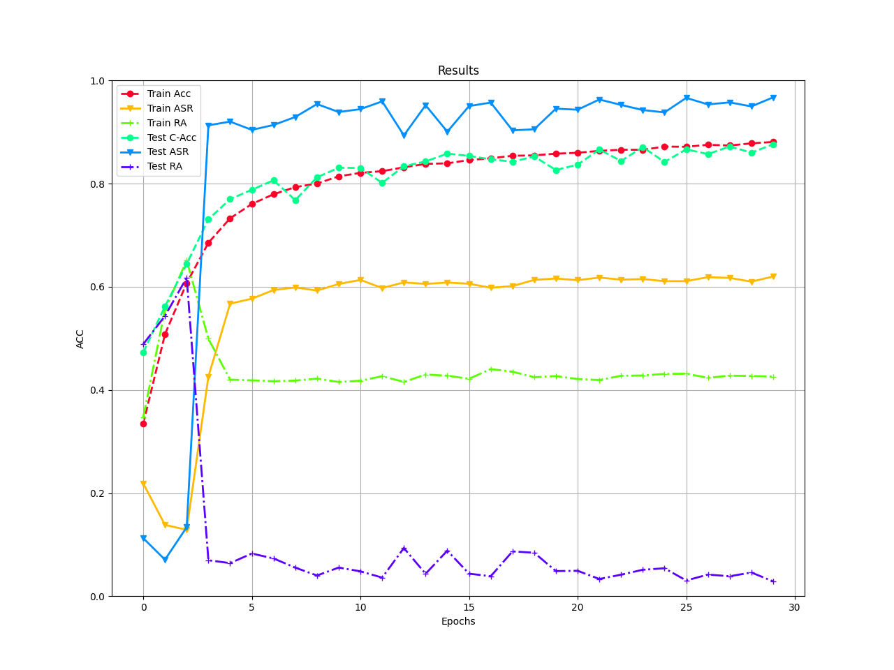
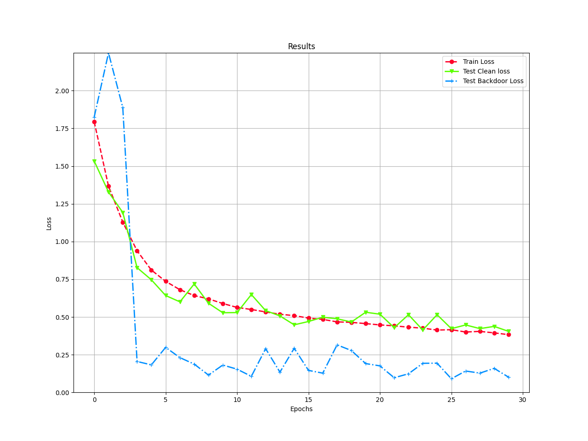
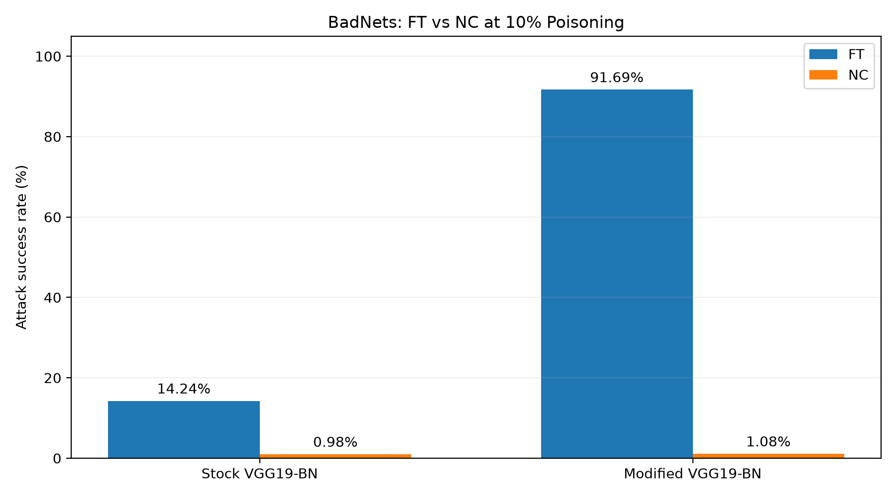

# Team M02: Backdoor defenses on BackdoorBench (ECE 424 midpoint)

**Team:** Shruthi Shankar (ss4592), Rahil Patel (rnp83), Ahmed Abouelkhir (aa2899)
**Paper:** *BackdoorBench* (Wu et al., NeurIPS 2022)
**Question:** how well do the FT and NC defenses remove BadNets and Blended backdoors on CIFAR-10 as the poisoning ratio drops (10%, 5%, 1%)?

## Results so far (BadNets, 10% poisoning, seed 0, one run each)

Model: `vgg19_bn_cifar` (Ahmed's modified VGG19-BN).

| Stage | Clean accuracy | ASR |
|---|---|---|
| Undefended attack | 0.8762 | 0.9671 |
| After NC | 0.9061 | 0.0108 |
| After FT (30 epochs) | 0.9041 | 0.9169 |

- **NC** flagged label 0, the true target (mask norm 5.09 vs 38.0 to 93.9 for the others, anomaly index 2.627; above about 2 counts as flagged).
- **FT** barely removed the backdoor on this model. On stock `vgg19_bn` it cut ASR from 0.929 to 0.142. We don't know why and have not tested an explanation.
- **Cross-check:** Ahmed's laptop run reached clean 0.8737 / ASR 0.9510. Rahil's Colab re-run of the same code and config reached 0.8762 / 0.9671.

Training curves for the Colab attack run (`vgg19_bn_cifar`):




More detail and the other runs: [`logs/README.md`](logs/README.md).

### Evaluation: FT vs NC across model configurations

Shruthi implemented an evaluation pipeline that extracts the final
attack and defense metrics from the existing experiment logs, computes
ASR reduction and clean accuracy change, and generates a comparison
CSV and visualization.

The initial evaluation compares BadNets at 10% poisoning on stock
VGG19-BN and Ahmed's modified VGG19-BN.

| Model | Defense | Baseline ASR | Defended ASR | ASR reduction |
|---|---|---|---|---|
| Stock VGG19-BN | FT | 92.86% | 14.24% | 78.61 pp |
| Stock VGG19-BN | NC | 92.86% | 0.98% | 91.88 pp |
| Modified VGG19-BN | FT | 96.71% | 91.69% | 5.02 pp |
| Modified VGG19-BN | NC | 96.71% | 1.08% | 95.63 pp |



NC reduced ASR to approximately 1% for both model configurations.
FT was substantially less effective on the modified model than on
the stock model. The reason for this difference remains unverified.

Evaluation scripts, generated results, and methodology are documented
in [`evaluation/README.md`](evaluation/README.md).

## Repo map

| Folder | Owner | Contents |
|---|---|---|
| `BadNets_Modified_VGG19BN + Results/` | Ahmed | Modified-model code, attack config, laptop run, and Ahmed's README with the attack steps |
| `BadNets_GitHub/` | Ahmed | First run, PreAct-ResNet18 (supplementary) |
| `logs/` | Rahil | Defense runs; see `logs/README.md` |
| `evaluation/` | Shruthi | Evaluation scripts, ASR and clean accuracy comparisons, generated results CSV, visualization, and methodology. See `evaluation/README.md`. |

## How to reproduce

Environment used: Google Colab free T4, Python 3.13, PyTorch 2.11. Do not use `install.sh` (it pins PyTorch 1.11).

**1. Setup**
```
git clone https://github.com/SCLBD/BackdoorBench.git
cd BackdoorBench
git checkout f02e3534645f0ee63d6848653062cd6c0d6c400d
sh ./sh/init_folders.sh
pip install kornia pyyaml scikit-learn scikit-image tqdm matplotlib pandas pytorch-wavelets
python -c "import torchvision; [torchvision.datasets.CIFAR10('./data/cifar10', train=t, download=True) for t in (True, False)]"
```

**2. Three one-line patches** for PyTorch 2.11 (failures explained below)
```
utils/save_load_attack.py : torch.load(save_path)  ->  torch.load(save_path, weights_only=False)
defense/nc.py             : "--num_workers", type=float  ->  type=int
defense/ft.py             : "--num_workers", type=float  ->  type=int
```

**3. Attack.** Follow Ahmed's README in `BadNets_Modified_VGG19BN + Results/`. Copy his `utils/aggregate_block/model_trainer_generate.py` and `config/attack/prototype/cifar10_vgg19_cifar.yaml` into BackdoorBench first. We ran his command with `--num_workers 2` added and `--save_folder_name badnet_vgg19_cifar_0_1`. About 30 min on a T4.

**4. Defenses**
```
python ./defense/nc.py --result_file badnet_vgg19_cifar_0_1 --yaml_path ./config/defense/nc/cifar10.yaml --dataset cifar10 --model vgg19_bn_cifar --num_workers 2
python ./defense/ft.py --result_file badnet_vgg19_cifar_0_1 --yaml_path ./config/defense/ft/cifar10.yaml --dataset cifar10 --model vgg19_bn_cifar --num_workers 2 --epochs 30
```
NC takes about 40 min (trigger search about 20, unlearning about 17). FT takes about 10 min.

**Check it worked:** the attack ends near clean 0.87 / ASR 0.95 to 0.97; NC prints `Flagged label list: 0: ...` and "This is a backdoor model". Clean accuracy of exactly 0.1 means the model collapsed; check the model name and yaml.

**5. Evaluation**

The evaluation scripts use existing experiment summary CSV files
in `logs/`. Retraining is not required to reproduce the comparisons.

From the root of this repository, run:

```bash
python evaluation/compare_results.py
```

This generates `evaluation/results_summary.csv`.

To generate the defense comparison visualization, install Matplotlib
if necessary:

```bash
python -m pip install matplotlib
```

Then run:

```bash
python evaluation/plot_results.py
```

This generates `evaluation/defense_comparison.png`.

The evaluation currently covers the completed BadNets 10% poisoning
experiments. Additional attack types and poisoning ratios will be
included as their results become available.

## Failures we hit
1. `Weights only load failed`: PyTorch 2.6+ defaults `torch.load` to `weights_only=True`. Fixed by patch 1.
2. `'float' object cannot be interpreted as an integer` in NC and FT: `--num_workers` is declared as float. Fixed by patches 2 and 3 (or omit the flag).
3. `Missing key(s)` when loading: the defense ran without `--model`. Always pass the same `--model` as the attack.
4. A 2-epoch attack has no backdoor (ASR 8%). Check ASR before defending.

## Protocol
- Clean accuracy over all 10,000 test images. ASR on the 9,000-image backdoor test set, consistent with excluding the 1,000 images already labeled class 0 [confirm in code].
- Matrix: 2 attacks x 2 defenses x 3 ratios. **Done:** BadNets 10%, both defenses. **Remaining:** 5%, 1%, Blended.
- Midpoint runs use default defense settings (FT at 30 epochs instead of 100). Final runs will tune on a validation split, then evaluate once on test.
- All numbers are single-seed baselines.
- Midpoint evaluation: The existing BadNets 10% poisoning results
  are compared across stock VGG19-BN and modified VGG19-BN.
- Evaluation metrics: ASR reduction is calculated as baseline ASR
  minus defended ASR. Clean accuracy change is calculated as
  defended clean accuracy minus baseline clean accuracy.
  Both differences are reported in percentage points.
- Evaluation implementation: `evaluation/compare_results.py`
  extracts metrics from the existing experiment summary CSV files.
  `evaluation/plot_results.py` visualizes the defended ASR values.
- Current limitations: Cross-attack comparisons, poisoning-ratio
  stress testing, and repeated-seed analysis remain incomplete.
  The observed difference in FT effectiveness between models
  has not yet been explained.

## Deviations from the proposal
- **Model:** proposal said VGG19. We use Ahmed's modified VGG19-BN and also report stock `vgg19_bn`. The paper's VGG-19 has no batch norm, so our numbers are not directly comparable to it. The instructor approved PreAct-ResNet18; [confirm `vgg19_bn_cifar` is acceptable].
- **Compute:** Colab free T4 instead of personal devices (approved by the instructor). Sessions reset and wiped the disk, so results were backed up to Drive and pushed here.
- **FT epochs:** 30 instead of 100.
- **Provenance:** Ahmed designed the model and ran it first; Rahil re-ran it on Colab so the defenses could run on it.

## Midpoint checklist
| Item | Where |
|---|---|
| 1. Runnable baseline | How to reproduce, above |
| 2. Trace and sanity check | **Fallback trace:** `logs/rahil_badnet_0_1_local/`. A 2-epoch model had no backdoor; the 30-epoch models reach ASR 0.93 to 0.97 and NC flags the true target. |
| 3. Bounded contribution | Failure analysis of FT and NC as poisoning drops, with per-case results beside totals. First finding: FT's residual ASR at 10% was 0.14 on stock `vgg19_bn` but 0.92 on `vgg19_bn_cifar`. Initial comparison scripts and results are in `evaluation/`. |
| 4. Member evidence | Commits by `aa2899` (attack), `patel1597` (defenses), `ShruthiS114` (evaluation) |
| 5. Protocol and logs | Experimental protocol above, attack and defense logs in `logs/`, and evaluation methodology, scripts, and generated results in `evaluation/`. |
