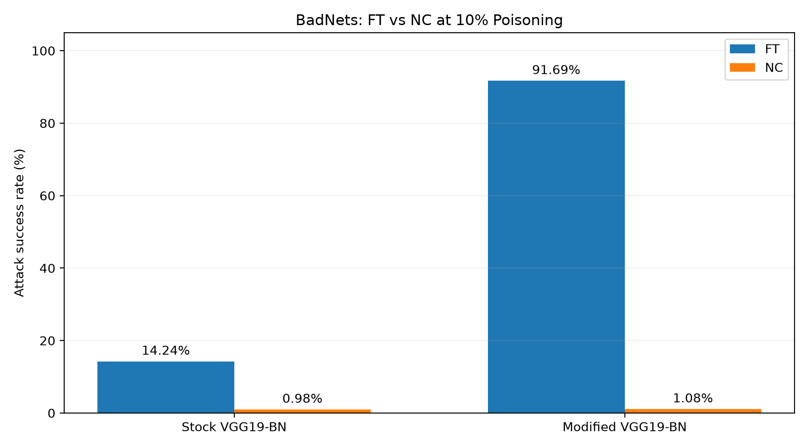

# Evaluation: BadNets Defense Comparison

## Overview

This directory contains the evaluation component for Team M02's BackdoorBench project. The evaluation compares the effectiveness of Fine-Tuning (FT) and Neural Cleanse (NC) against BadNets attacks on CIFAR-10 using two model configurations: stock VGG19-BN and modified VGG19-BN.

This initial evaluation uses the existing 10% poisoning experiments completed by the attack and defense pipelines. Future work will extend the analysis to Blended attacks and poisoning ratios of 5% and 1%.

## Files

- `compare_results.py`: Reads existing attack and defense metric CSVs, calculates ASR reduction and clean accuracy changes, and generates a summary CSV.
- `plot_results.py`: Generates a bar chart comparing defended ASR across models and defenses.
- `results_summary.csv`: Generated comparison results.
- `defense_comparison.png`: Visualization of FT and NC effectiveness.

## Methodology

The evaluation reads the final recorded clean accuracy and attack success rate (ASR) from the experiment summary files in the repository's `logs/` directory.

For each model-defense combination, the script computes:

- **ASR reduction (percentage points)** = Baseline ASR − Defended ASR
- **Clean accuracy change (percentage points)** = Defended clean accuracy − Baseline clean accuracy

The results compare the same attack setting before and after applying each defense.

## Results

| Model | Defense | Baseline ASR | Defended ASR | ASR Reduction |
|---|---|---:|---:|---:|
| Stock VGG19-BN | FT | 92.86% | 14.24% | 78.61 pp |
| Stock VGG19-BN | NC | 92.86% | 0.98% | 91.88 pp |
| Modified VGG19-BN | FT | 96.71% | 91.69% | 5.02 pp |
| Modified VGG19-BN | NC | 96.71% | 1.08% | 95.63 pp |



## Observations

Neural Cleanse reduced attack success rate to approximately 1% for both model configurations.

Fine-Tuning was substantially more effective on stock VGG19-BN than on modified VGG19-BN. The residual ASR after FT was 14.24% for the stock model compared with 91.69% for the modified model.

This difference warrants further investigation into model architecture, training configurations, and defense behavior. The current evaluation does not establish the cause.

## Reproduction

From the repository root directory, run:

```powershell
python .\evaluation\compare_results.py
```

To generate the visualization, install Matplotlib if necessary:

```powershell
python -m pip install matplotlib
```

Then run:

```powershell
python .\evaluation\plot_results.py
```

The scripts generate `results_summary.csv` and `defense_comparison.png` inside the `evaluation/` directory.

## Limitations and Future Work

- Current comparisons cover BadNets at 10% poisoning only.
- Results come from existing single-run experiments; no repeated-seed statistical analysis has been performed.
- The two model configurations may differ in more than architecture, so the observed difference in FT effectiveness cannot yet be attributed to a particular cause.
- Future evaluation will compare BadNets and Blended attacks at 10%, 5%, and 1% poisoning.
- The evaluation scripts will be extended as additional experiment results become available.

## Individual Contribution

Shruthi Shankar implemented the evaluation scripts, automated extraction and comparison of attack and defense metrics, generated the visualization, and documented the preliminary findings. The underlying attack and defense experiments were conducted by Ahmed Abouelkhir and Rahil Patel, respectively.